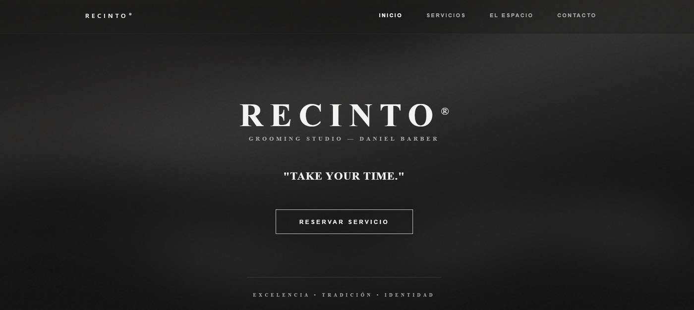
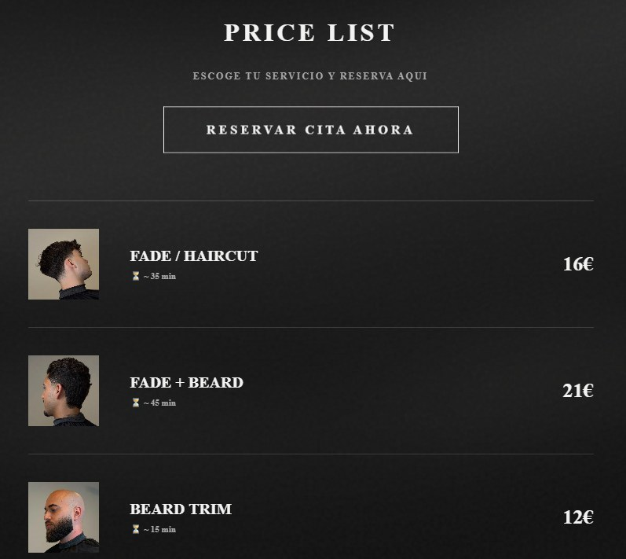
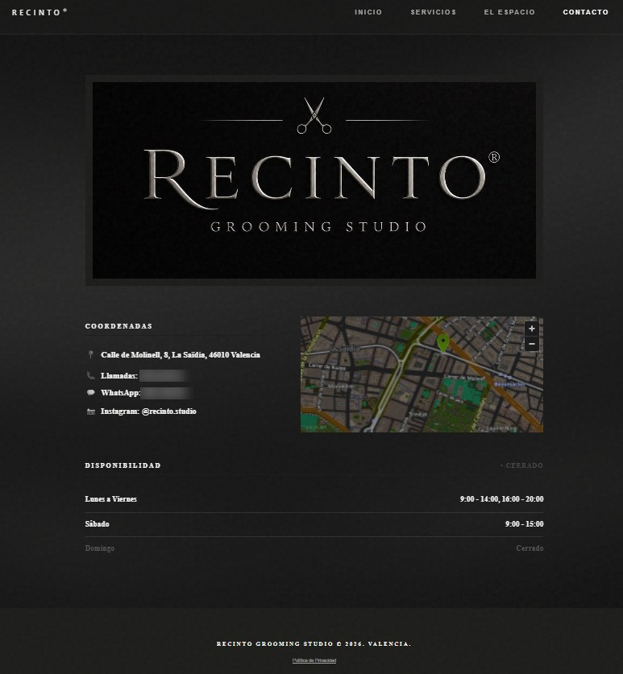

# Recinto Grooming Studio: Barbershop Website


Website for a real barbershop in Valencia, with a dark editorial look, a price list, opening hours with a live open or closed indicator, and a booking button that sends clients to the shop's Booksy page.

**Live site:** [recintostudio.com](https://www.recintostudio.com/)

## About the project

Freelance project built for a local business: a site that presents the studio, lists its services with prices and makes booking one click away. The site is in Spanish.

## Screenshots

<p align="center">
  
</p>

<p align="center">
  
  &nbsp;
  
</p>

*Home page, price list and contact page.*

## Features

- **Five views:** home, services, the space, contact and privacy policy, with a navigation bar that highlights the current section.
- **Price list:** each service shows a photo, its duration and its price.
- **Online booking:** the booking buttons open the shop's Booksy page, so appointments are managed in a tool the barber already uses.
- **Live opening status:** the contact page shows "open" or "closed" by comparing the current day and time with the weekly opening hours.
- **Location:** address with a link to Google Maps and an embedded OpenStreetMap map.
- **Social link:** direct link to the studio's Instagram.
- **Visitor analytics:** page views measured with Vercel Web Analytics.

## Tech

| Area | Technology |
|---|---|
| Front end | React 18 with function components and hooks |
| Build | Create React App (`react-scripts`) |
| Styling | Inline styles driven by a single colour palette, plus a component with custom CSS animations |
| Map | OpenStreetMap embed |
| Booking | Booksy (external link) |
| Analytics | Vercel Web Analytics |

## Project structure

```
.
├── public/        Photos and logo of the studio
├── src/
│   ├── App.js     Views and components of the site
│   ├── index.js   App entry point
│   └── style.css  Base typography
└── package.json
```

## Design decisions

- **No router.** With only five views, the active page is kept in a single piece of state, which keeps the app simple and avoids an extra dependency.
- **Booking handled by Booksy.** Instead of building a custom booking system, the site links to the shop's existing Booksy page, so appointments stay in a single tool for the barber.
- **One colour palette.** All colours come from one object, so the look of the whole site can be changed in a single place.
- **Computed opening status.** The open or closed label is calculated from the weekly schedule instead of being edited by hand.

## Run it locally

```bash
npm install
npm start
```

The site opens at `http://localhost:3000`.

## Rights

The name, logo and photographs belong to Recinto Grooming Studio and are shown here as part of a portfolio. They are not licensed for reuse.
